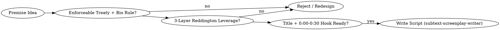

# Mythic Story Architect

## Overview
Build **Primal Dark Mythological Cinema**: universal, heart-wrenching human bonds (betrayed king, condemned mother, forsaken soldier, thrown sacrifice) collided with ancient, hyper-rational nonhuman realms. **Primal emotion + terrifying creature devotion wins 20M–100M clicks; invisible world rules & shocking betrayals win 15+ minute watch time.**

## Iron Laws — No Exceptions
1. **Primal Myth First, Rules Invisible (NO Dry Legal/Sci-Fi Puzzles):** NEVER write courtroom clerk tricks, tax/quarantine loopholes, or medical/engineering gadget plots (`hydrophones`, `serum tubes`, `disinheritance writs`). Ground every premise in timeless primal bloodlines & archetypes: **Crown, Child, Mother, Brother, Bride, Prisoner, Beast, Dragon, Oath, Vengeance.** World rules govern consequences *underneath*, never as dry dialogue lectures.
2. **ZERO Fairytale Slop or Black-Screen Openings (`0:00–0:25`):** Never pitch cute pet dragons, random jump-scares, extended black frames, or `0:25` title interruptions. Open frame `0:00` on an unmistakable physical act of mercy, betrayal, or dread.
3. **`But / Therefore` Causality Only:** Never link beats with *"and then"*. Every turn wounds deeper: tenderness between human & monster contrasted against ruthless betrayal by human kin.
4. **Prop & Cast Math Ledger Required:** Track exact headcount and key object counts per scene (`3 launched - 2 destroyed = 1 returning`). Max `1–2` hero subjects per close action beat — **NO "dozens of pale hands" AI-breaking crowds**.

## Mandatory Deliverables Before Scripting
1. **Treaty World Operating System (`Institution · Treaty · Enforcement · Biology · Jurisdiction · Leverage · Irreversible Price`)** — see [treaty-os-and-pressure-map.md](references/treaty-os-and-pressure-map.md).
2. **3-Layer Objective Stack:** `Apparent Objective` | `Actual Objective` | `Hidden Objective`.
3. **5-Beat Cold Open (`0:00–0:30`):** Impossible procedural act (`0–3s`) -> operational tools (`3–8s`) -> expectation violation (`8–14s`) -> 1–2 weaponized lines (`14–21s`) -> irreversible institutional shift (`21–30s`).
4. **90–120s Re-Stakes Cadence & Serialized Lore (`universeLinks`):** Long-form (`10–18m`) acts MUST escalate stakes every `90–120s` via physical/legal reversals (Midpoint Objective Flip at `~50%`, False Compliance Trap at `~75%`), recording surviving witnesses and unpaid debts in `film.json` (`universeLinks`) for sequel binge hooks.
5. **18-Min Narrative Pressure Map + Continuity Math Table**, registered via `film_create` and `sequence_state_plan`.

## Red Flags — Stop & Re-Break If You Think This
| Rationalization | Reality & Fix |
| --- | --- |
| *"Budget is tight; skip treaty depth and summarize in narration."* | Summarized lore kills YouTube retention. Replace dialogue lectures with one physical boundary rule violated on camera. |
| *"A moody 5s black screen builds atmosphere before the scene."* | Viewers swipe off black screens in 2s. Open on frame 0:00 with physical procedural action. |
| *"Dramatic monster hands/crowd swarming adds cheap scale."* | Multi-limb crowds hallucinate and morph in AI video. Cap foreground bodies at `1–2` and imply scale via architecture and sound. |
| *"Let's pick an artistic 2-word title like 'THE ASH CLAUSE'."* | Cryptic 2-word titles fail cold browse CTR. Hand title & thumbnail to `youtube-thumbnail-packaging-director`. |
| *"This clever sci-fi/legal loophole makes the human smart."* | Audiences don't crave legal trivia or gadget names — they click raw emotion (`Mother / King / Child / Beast / Betrayal`). Hide the mechanics underneath visceral drama. |

**NEXT REQUIRED SKILL:** `subtext-screenplay-writer` once outline and Continuity Math Ledger are locked.
