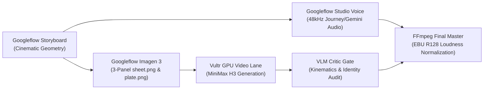

# FLOW AI & GOOGLE AI STUDIO PRO DIRECTING DOCTRINE

The **Flow AI** engine (`googleflow_mcp`) bridges Google AI Studio (Google AI Pro subscription), Google Cloud Text-to-Speech Journey voices, and Vultr Serverless Inference (MiniMax H3) into the Frontier Studio MCP architecture.

---

## 1. Core Capabilities & Tool Catalog

| Tool Name | Engine / Model | Purpose | Key Parameters |
|---|---|---|---|
| `googleflow_storyboard_cinematic` | Hollywood Showrunner + Gemini | Screenplay & camera geometry generation | `title`, `logline`, `characters`, `num_scenes`, `genre` |
| `googleflow_generate_image` | Google **Imagen 3** (`imagen-3.0-generate-002`) | Character sheets, 3-panel turnarounds, environment plates | `prompt`, `output_path`, `aspect_ratio` ("16:9", "9:16", "1:1"), `negative_prompt` |
| `googleflow_synthesize_voice` | **Google AI Studio** Gemini 2.0 & **Journey HD TTS** | Consistent character dialogue & cinematic narration | `text`, `output_path`, `voice_name` (`en-US-Journey-D`, `Charon`, `Puck`, `Aoede`), `language_code` |
| `googleflow_generate_campaign_strategy` | Direct Response Marketing Engine | Viral hooks, PAS frameworks, TikTok/Reels ads | `product_url`, `angle`, `aspect_ratio`, `duration_sec` |
| `googleflow_extract_product_intelligence` | Web Extractor & NLP | Scrapes listing features, customer praises, pain points | `url` |
| `googleflow_run_full_ad_pipeline` | Autonomous Marketing Engine | One-shot extraction -> storyboard -> voice -> video render | `product_url`, `angle`, `aspect_ratio`, `voice_name` |

---

## 2. Character Reference Consistency & Imagen 3 Rules

### A. The 3-Panel Headless Turnaround Standard
When generating a character reference sheet (`sheet.png`) for any film lead:
- **Mandatory Shot Layout:** "Three-panel character turnaround sheet: front view on left, 45-degree three-quarter profile in center, pure profile on right. Same character, same costume, neutral standing pose, studio key light with rim lighting, clean dark gray backdrop."
- **Model:** `imagen-3.0-generate-002` via Google AI Studio (`GEMINI_API_KEY`).
- **Aspect Ratio:** `16:9`.
- **Negative Prompts:** `"inconsistent facial features, clothing changes between panels, cartoonish, low resolution, extra limbs, anime style, oversaturated colors, flat lighting"`.

### B. Environment Key Plates (`plate.png`)
- **Lens Framing:** Panavision Anamorphic C-Series (35mm wide establishing or 50mm locked).
- **Aspect Ratio:** `16:9` (2.39:1 scope letterboxed).
- **Aesthetic Guidance:** Authentic 35mm film stock (Kodak 5219 500T), atmospheric particulate haze, volumetric lighting, rich chiaroscuro shadows.

---

## 3. Vocal Nuance & Voiceover Selection Matrix

Google Flow provides two premier vocal tiers:

### Tier 1: Google AI Studio Gemini 2.0 Audio
Accessed by passing one of the Google AI Studio voice personas:
- **`Charon`**: Deep, measured, weathered masculine gravitas. Best for ancient mentors, hardened warriors, sovereign rulers (e.g. Master Corvus Vance).
- **`Fenrir`**: Gritty, aggressive, raspy baritone. Best for antagonists and creatures (e.g. Malic, beast summoners).
- **`Aoede`**: Sophisticated, melodic, precise feminine resonance. Best for high-status diplomats, royalty, and mythical entities.
- **`Puck`**: Agile, sarcastic, dynamic cadence. Best for rogue tricksters, quick-witted scavengers.
- **`Kore`**: Warm, compassionate, grounded feminine tone.

### Tier 2: Google Cloud Text-to-Speech Journey HD
Lossless 48kHz linear PCM audio with natural human cadence:
- **`en-US-Journey-D`**: Rich authoritative baritone. The gold standard for dark epic cinema narration.
- **`en-US-Journey-F`**: Expressive, articulate feminine delivery.
- **`en-US-Journey-O`**: Deep resonance with documentary intimacy.

---

## 4. End-to-End Pipeline: Storyboard -> Sheet -> Voice -> Vultr Animate

To direct an A-list sequence using Google Flow AI:

1. **Lock Sequence**: Call `googleflow_storyboard_cinematic` with the film's premise.
2. **Lock Reference Assets**: Call `googleflow_generate_image` for character sheets and plate backgrounds.
3. **Record Dialogue**: Call `googleflow_synthesize_voice` for each shot's lines.
4. **Animate on Vultr**: Pass `sheet.png` / `plate.png` alongside the motion prompt to Vultr MiniMax H3.
5. **Quality Gate**: Audit the resulting video takes with `qa/critic.ts`.
6. **Master Cut**: Concatenate passes and mix dialog stem at -23 LUFS.
