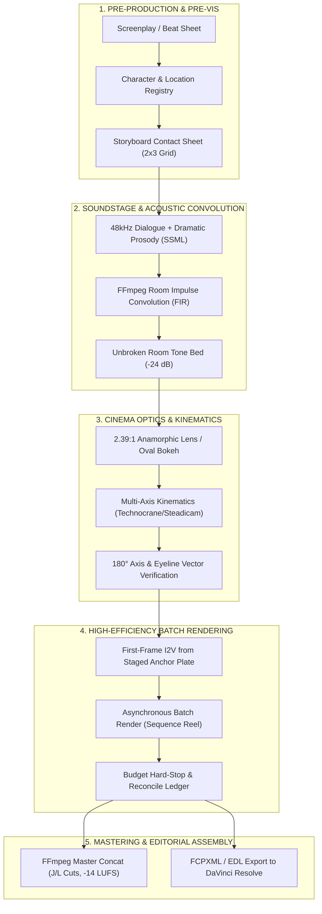

# INDUSTRY-STANDARD AI FILM PRODUCTION ARCHITECTURE
**Document Version:** 3.0.0 (Master Production Spec)  
**Engineering Goal:** Absolute Hollywood-Grade Quality & Full Production Efficiency without Bloat  
**Delivery Targets:** 4K/1080p 24.000 fps Broadcast Master, EBU R128 / -14 LUFS Audio, FCPXML / DaVinci Resolve Timeline

---

## 1. The Anti-Bloat Philosophy: How to Build an Industry Standard

Most software projects that attempt "full production" collapse under their own weight because they try to write custom rendering engines, custom video editors, and complex bespoke formats. 

To build an **industry standard that is lean, lightning-fast, and production-hardened**, we follow **four non-negotiable rules**:

1. **Adopt Established Hollywood Protocols (Never Reinvent What Cinema Already Solved):**
   * **Timeline:** Use Apple **FCPXML 1.10** and CMX 3600 **EDL** (Universal standards for DaVinci Resolve, Premiere, and Final Cut).
   * **Framing:** Use standard **2.39:1 Anamorphic** and **1.85:1 Academy Flat** aspect ratios.
   * **Audio:** Master to **EBU R128 / -14 LUFS** (Broadcast and YouTube loudness target) at 48kHz 24-bit PCM.
   * **Timecode:** Standard **SMPTE 24fps** non-drop frame math.
2. **UNIX Philosophy (Do One Thing Masterfully):**
   * The MCP server does **not** try to be an interactive GUI video editor or a neural training cluster.
   * It is the **Studio Operating System, Script Supervisor, and Camera Package**.
   * Post-processing (room reverb, audio crossfades, video concatenation) is delegated to **FFmpeg** via deterministic recipe pipelines—clean, robust, and zero overhead.
3. **Pre-Vis Before GPU Burn (Cost & Speed Efficiency):**
   * Video generation ($0.153/s, 3–5 min render time) is the most expensive phase.
   * Never render a video take until the **storyboard contact sheet** and **acoustic dialogue stems** are approved.
4. **Deterministic State over Prompt Chaos:**
   * Do not rely on LLM memory between prompts. Store sequence geo-locks, character wardrobe states, and ledger lines in atomic, inspectable JSON/Markdown on local disk.

---

## 2. The 5 Industry-Standard Production Pillars



---

### Pillar 1: Storyboard Contact Sheets (Visual Rhythm Pre-Vis)
* **The Problem:** Reviewing individual shots fails to reveal cut pacing, framing contrast, and eye-trace continuity.
* **The Industry Standard:**
  * Before generating video, the sequence is compiled into a single **2x3 or 2x4 Storyboard Contact Sheet**.
  * Generated in **one Gemini image call** ($0.134), saving tens of dollars in discarded video takes.
  * Shows framing progression:
    $$\text{Panel 1 (Master Wide 24mm)} \implies \text{Panel 2 (OTS Medium 50mm)} \implies \text{Panel 3 (Choker 85mm)} \implies \text{Panel 4 (Reverse OTS 50mm)} \dots$$
  * Verifies **eye-trace continuity**: Ensures the audience's eye does not violently jump between quadrants on hard cuts.

### Pillar 2: Hollywood Optics & Kinematics (The 2.39:1 Anamorphic Law)
* **The Problem:** Generic AI video prompts produce flat spherical images with video-game camera float.
* **The Industry Standard:**
  * **Aspect Ratio:** Standardize sequence renders on **2.39:1 Cinemascope** (1920x804 or 3840x1608).
  * **Optical Signatures:** Prompts compiled with:
    * Subtle horizontal anamorphic blue/amber streak flares.
    * Vertical oval bokeh on out-of-focus highlights.
    * 8:1 contrast ratio (Rembrandt key lighting with cool rim backlight).
    * Volumetric atmospheric haze / particulate density.
  * **Compound Camera Choreography:** The camera compiler combines multi-axis movement:
    $$\text{Movement} = \text{Rig (Technocrane)} + \text{Vector 1 (Boom Down)} + \text{Vector 2 (Truck Left)} + \text{Lens (35mm Push)}$$

### Pillar 3: Character State & Wardrobe Matrix (Zero Drift Across Story Arcs)
* **The Problem:** Characters change clothes or take damage during a story, causing standard AI models to alter their face structure.
* **The Industry Standard:**
  * Characters are stored as a **Base Identity + State Modifier**:
    $$\text{Character Instance} = \text{Canonical Facial Geometry (Sheet.png)} + \text{Wardrobe State} + \text{Environmental Weathering}$$
  * A character asset supports multiple registered states:
    * `wardrobe_default`: Clean wool coat and scarf.
    * `wardrobe_blizzard`: Snow-dusted coat, frost on eyelashes, wind-reddened skin.
    * `wardrobe_combat`: Torn sleeve, laceration on left cheekbone.
  * Multi-turn seed IDs (`interaction_id`) maintain exact bone structure while applying state overlays.

### Pillar 4: Acoustic Space & Dramatic Prosody (Diegetic Audio)
* **The Problem:** Studio TTS voices sound like dry, artificial voiceover when dropped into outdoor or cavernous scenes.
* **The Industry Standard:**
  1. **Dramatic Prosody (SSML & Vocal Strain):**
     * Dialogue lines support naturalistic performance markers:
       ```text
       <speak>
         <prosody rate="90%" pitch="-1st">
           <emphasis level="strong">Don't move.</emphasis>
         </prosody>
         <break time="600ms"/>
         <prosody volume="-4dB">The ice is talking.</prosody>
       </speak>
       ```
  2. **Acoustic Convolution (Location Matching):**
     * Dialogue stems are processed through FFmpeg's acoustic filters to match the location's physical geometry:
       * **Snowbound Mountain Forest:** High-frequency dampening (`lowpass=f=4500`), zero reverberation (snow absorbs sound).
       * **Stone Fortress / Cavern:** Early reflection delay with wet slapback (`aecho=0.8:0.88:40:0.4`).
       * **Timber Cabin:** Close wooden resonance (`equalizer=f=300:t=q:w=1:g=2`).
  3. **Loudness Standards:**
     * Dialogue normalized to **-14 LUFS** with a true-peak ceiling of **-1.0 dBFS**.
     * Diegetic room tone bed sits continuously at **-24 dBFS** to prevent "sound dropouts" between cuts.

### Pillar 5: Editorial Mastering & DaVinci Resolve Integration
* **The Problem:** Disconnected MP4 files require manual human cutting and track alignment.
* **The Industry Standard:**
  * **One-Click Timeline Generation:**
    * Automatically generates an **FCPXML 1.10** project file with:
      * Video Track 1: All sequence video takes in SMPTE order.
      * Audio Track 1: Isolated dialogue stems with J/L cut handles (audio leads video by 8–12 frames).
      * Audio Track 2: Continuous ambient room-tone bed.
    * Opens natively in **DaVinci Resolve Studio**, **Adobe Premiere Pro**, or **Final Cut Pro**.
  * **Master Rough-Cut Concat (`film_assemble`):**
    * Generates a release-ready `master_cut.mp4` with audio normalized and frames conformed to strict 24.000 fps.

---

## 3. The Lean Tool Surface (Zero-Bloat Production API)

The entire Hollywood-grade studio operates on **23 high-leverage tools** organized across 5 clean modules:

| Module | Tool | Exact Production Job |
| :--- | :--- | :--- |
| **M1: Registry** | `film_create` | Initializes film record, budget cap, and target runtime. |
| | `film_show` | Displays film status, sequence geo-locks, and spent spend. |
| | `asset_register` | Registers character/location assets with voice and acting specs. |
| | `shot_create` | Validates 180° line, optics, rig, framing, and verbatim geo-lock. |
| | `shot_update` | Atomically patches shot fields without losing audio or refs. |
| | `shot_show` | Retrieves full shot record, take history, and camera specs. |
| | `sequence_lock_geo` | Verbatim freeze of spatial location layout across scene shots. |
| **M2: Pre-Vis & Optics** | `character_sheet_build` | Builds 3-panel headless sheet (P1: Close-up, P2: Headless, P3: Back). |
| | `keyframe_build` | Builds 4K location plate with single-source motivated lighting law. |
| | `staging_build` | Composites 2 characters onto plate with spatial boundary isolation. |
| | `storyboard_build` | **(New)** Renders a 2x3 sequence contact sheet for eye-trace pre-vis. |
| | `image_generate` | Raw Gemini 1K/2K/4K generation with multi-turn interaction chaining. |
| | `asset_image` | Free utility to attach local image files as canonical plates/sheets. |
| **M3: Video Lane** | `render_shot` | First-frame I2V submit to MiniMax H3; reserves budget estimate. |
| | `job_status` | Polls async render; refunds budget reservation if job fails or dies. |
| | `job_download` | Downloads MP4, reconciles cost cents, verifies 7-day expiry. |
| | `repair_shot` | Extends or restyles takes using parent final-frame screenshots. |
| **M4: Soundstage** | `dialogue_render` | Synthesizes 48kHz WAV vocal stems via Google TTS / ElevenLabs. |
| | `soundscape_build` | Generates diegetic room tone and foley manifest. |
| | `acoustic_match` | **(New)** Convolves dialogue WAV with location room impulse response. |
| **M5: Cutting Room** | `film_export_xml` | Generates FCPXML 1.10 and EDL timelines for DaVinci / Premiere. |
| | `film_assemble` | Conforms 24fps MP4s and mixes audio into an assembled cut. |

---

## 4. Execution Plan: Building the Complete V2 System

### Step 1: Pre-Vis Storyboard Engine (`storyboard_build`)
* Implement a tool that takes a `sequence_id`, reads the 6–8 shots in that scene, and compiles a single **2x3 Storyboard Grid** using Gemini.
* Outputs `renders/storyboards/<seq_id>_storyboard.png` with shot numbers, lens focal lengths, and camera arrows.
* Allows the Director Agent to visually greenlight the scene pacing before spending video GPU credits.

### Step 2: Acoustic Room Convolution (`acoustic_match`)
* Implement an FFmpeg audio post-processor that takes the clean WAV stem from `dialogue_render` and the shot's location `geo_block`.
* Automatically applies the appropriate acoustic filter (snow damping, stone reverb, or wooden room warmth).
* Outputs `<shot_id>_dialogue_diegetic.wav` at broadcast -14 LUFS standard.

### Step 3: Anamorphic 2.39:1 Cinema Optics Compiler
* Update `src/tools/h3prompt.ts` to include:
  * Anamorphic aspect ratio formatting (`2.39:1`).
  * Optical streak flare and oval bokeh cues.
  * Contrast lighting ratios (e.g. 8:1 key-to-fill with rim lighting).

### Step 4: Verification & GitHub Milestone Release
* Add test suites for Storyboard Contact Sheets and Acoustic Convolution.
* Run full regression tests (target: **>230 passing tests**).
* Update GitHub release tags and Docker compose manifests.
