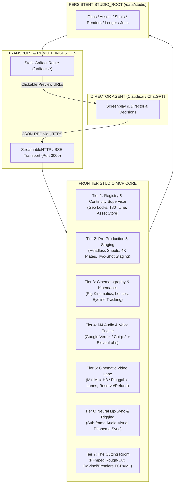
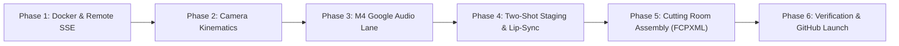

# TOP-NOTCH PRODUCTION BLUEPRINT: FRONTIER STUDIO MCP
**Document Version:** 2.0.0  
**Target Architecture:** End-to-End Autonomous AI Film Studio Engine  
**Execution Standard:** Feature-Film / Broadcast HD (1080p/4K 24fps)

---

## 1. Executive Summary & Production Philosophy

`frontier-studio-mcp` is evolving from a strict camera registry and video submitter into an **end-to-end autonomous AI film studio**. 

Most AI video tools fail to produce watchable cinema because they treat filmmaking as isolated prompt-to-video generation. Real filmmaking is **relational, physical, and grammatical**:
1. **Physical Continuity:** Actors must retain identical wardrobe, facial features, and vocal timbre across dozens of scenes.
2. **Grammatical Camera Language:** Camera movements must be physically motivated by rigs (Steadicam, Technocrane, Dolly) with deliberate optical choices (focal length, depth of field) and unbroken spatial rules (the 180° line and eyeline vectors).
3. **Audio-Driven Drama:** Over 50% of cinematic perception is sound. Dialogue must possess emotional dynamic range, vocal consistency, diegetic room tone, and mouth-accurate synchronization.
4. **Editorial Cohesion:** Shots must assemble into a non-linear timeline with pacing, J/L-cuts, and room-tone beds—not exist as loose MP4 files in a folder.

This blueprint establishes the complete 7-tier architecture, system schemas, Docker infrastructure, and phase-by-phase implementation plan required to achieve **top-notch cinematic production** directly from an AI Director Agent (Claude or ChatGPT).

---

## 2. The 7-Tier Studio Architecture



---

## 3. Deep Dive: The 7 Studio Tiers

### Tier 1: Registry, Continuity & Script Supervision (The First AD)
* **Status:** Existing (M1 Core) — Needs 180° Line & Eyeline Expansion.
* **Role:** The mechanical rule-enforcer. Prevents any tool call from progressing if it violates scene doctrine.
* **Core Laws Enforced:**
  * **Asset Completeness:** Characters require validated `descriptor.md`, `voice.md`, and `acting.md` before being referenced.
  * **Verbatim Spatial Geo-Locks:** Once a sequence location geometry (`geo_block`) is locked, every single shot in that scene must paste the spatial map byte-for-byte.
  * **The 180-Degree Law:** The registry validates subject screen position (`left`, `right`, `center`) and gaze vector (`screen_left`, `screen_right`). A reverse-angle shot that accidentally crosses the axis of action is refused with a structured `ValidationRefused` error and a `NEXT:` fix.

### Tier 2: Pre-Production, Visual Identity & Two-Character Staging
* **Status:** Existing for Single Characters (M2 Image Lane) — Needs Two-Character Staging Tool.
* **Role:** Establishes visual ground truth before any expensive video GPU time is spent.
* **Core Mechanisms:**
  * **Headless Reference Sheet Law:** Generates 3-panel sheets on neutral `#e8e8e8` backdrops. Panel 1 is a tight close-up face; Panel 2 is a full-body **headless** figure (terminating at the collar); Panel 3 is the rear view. This completely eliminates the AI "twin face" anomaly.
  * **Keyframe Light Law ("Never Two Suns"):** Location plates require an explicit `light_statement` declaring one motivated light source and shadow direction.
  * **Two-Shot Staging Engine (`staging_build`):** Solves the classic "identity bleed" problem where two characters in the same frame merge features. Uses multi-turn seed anchoring to place Character A on the left mark and Character B on the right mark before passing the plate to Image-to-Video (I2V).

### Tier 3: Cinematography, Optics & Kinematics
* **Status:** Upgrade Needed. Currently string-based; upgrading to structured kinematics.
* **Role:** Translates narrative emotion into optical physics.
* **Upgraded Schema (`CameraBlock`):**
  ```typescript
  export interface CameraBlock {
    lens_mm: 24 | 35 | 50 | 85 | 135;
    rig: 'tripod' | 'steadicam' | 'handheld_documentary' | 'technocrane' | 'dolly_track' | 'orbit_rig';
    movement: 'static' | 'pan' | 'tilt' | 'dolly_in' | 'dolly_out' | 'truck' | 'pedestal' | 'rack_focus';
    framing: 'extreme_wide' | 'master_wide' | 'medium_ots' | 'close_up' | 'extreme_close_up';
    screen_direction: 'screen_left' | 'screen_right' | 'center';
    eyeline_target?: string; // asset_id of the character being looked at
    depth_of_field: 'deep' | 'shallow' | 'rack_focus';
    reason: string; // Mandatory dramatic motivation
  }
  ```
* **Kinematic Compilation (`h3prompt.ts`):** Maps rigs and movements into exact model velocity instructions (e.g., `steadicam + truck_left` compiles into smooth stabilized lateral motion rather than jittery wandering).

### Tier 4: M4 Audio & Voice Engine (The Soundstage)
* **Status:** New Module (`src/lanes/audio.ts` & `src/tools/audio.ts`).
* **Role:** Generates broadcast-grade 48kHz vocal performances and diegetic sound beds.
* **Dual-Engine Architecture:**
  1. **Google Cloud / Vertex Audio (Primary / Default):**
     * Uses the existing `GEMINI_API_KEY` / Google Cloud infrastructure.
     * Utilizes Google Cloud TTS (Chirp 2 HD) and Gemini 2.0 Multimodal Audio to generate dialogue with contextual acting prompts (whispering, gasping, weeping, shouting).
     * Zero additional vendor subscriptions or API keys required.
  2. **ElevenLabs Adapter (Specialized Character Cloning):**
     * Drop-in secondary lane for characters requiring exact voice cloning (e.g. uploading a 30s voice sample and locking a permanent `voice_id`).
* **Soundscape Generation:**
  * Generates uninterrupted diegetic room-tone beds (wind, crackling hearth, room resonance).
  * In video prompts, non-diegetic music is strictly forced to `N/A` (music belongs in post-production).

### Tier 5: Cinematic Video Generation & Repair Lineage
* **Status:** Existing (M3 Vultr MiniMax H3 Lane) — Top-tier.
* **Role:** Synthesizes 24fps live-action photorealism with strict financial safety.
* **Core Guarantees:**
  * **First-Frame I2V Anchoring:** The keyframe plate is passed as `Picture 1` at 0.00s, transferring identity directly without facial morphing.
  * **Budget State Machine:** Pre-flight hard stop (`ensureBudget`) $\rightarrow$ **Reserve** estimate at submit $\rightarrow$ **Reconcile** actual cost at download $\rightarrow$ **Refund** reservation if a job fails or expires.
  * **Repair Lineage (`repair_shot`):** Allows extending takes using the parent job's final frame or restyling takes with full audit trails in `ledger.jsonl`.

### Tier 6: Neural Lip-Sync & Rigging
* **Status:** New Module (`src/tools/lipsync.ts`).
* **Role:** Solves the synthetic dialogue problem by mapping vocal audio onto video takes.
* **Mechanism:**
  * `shot_sync_lips({ shot_id })`: Takes the downloaded MP4 take and the generated 48kHz WAV audio stem.
  * Submits them to a lip-sync engine (e.g., SyncLabs API or local LivePortrait/Wav2Lip runner).
  * Produces `renders/<job_id>/shot_synced.mp4` with natural phoneme mouth alignment.

### Tier 7: The Cutting Room (Editorial Assembly & Export)
* **Status:** New Module (`src/tools/editor.ts`).
* **Role:** Bridges the gap between disconnected clips and a finished feature film.
* **Capabilities:**
  1. **Automated FFmpeg Assembly (`film_assemble`):**
     * Reads all `kept` shots in the active film or sequence in chronological order.
     * Trims head/tail handles.
     * Lays down an unbroken room-tone bed and mixes vocal stems with 0.3s crossfades (emulating professional J-cuts and L-cuts).
     * Outputs `renders/rough_cut.mp4` ready for immediate viewing.
  2. **Professional NLE Timeline Export (`film_export_xml`):**
     * Generates a standard **FCPXML** (Final Cut Pro XML) and **EDL** file.
     * When imported into **DaVinci Resolve** or **Adobe Premiere Pro**, all 40+ shots are pre-populated on Video Track 1, vocal stems on Audio Track 1, and soundscapes on Audio Track 2 with accurate timecodes and reel names.

---

## 4. Docker Architecture & Remote Ingestion

To allow **Claude.ai (Web)**, **ChatGPT**, or autonomous multi-agent swarms to run the studio without freezing local machines, the server is packaged as a cloud-ready Docker service.

### Directory Structure & Data Persistence
```
/ (Container Root)
├── app/
│   ├── dist/server.js       # Compiled TypeScript MCP Server
│   ├── package.json
│   └── node_modules/
└── data/studio/             # PERSISTENT DOCKER VOLUME (STUDIO_ROOT)
    ├── studio.json
    └── films/
        └── <film_id>/
            ├── film.json
            ├── assets/
            ├── shots/
            ├── audio/       # Generated 48kHz WAV stems
            ├── renders/     # Downloaded and synced MP4s
            ├── timelines/   # FCPXML and EDL files
            └── ledger.jsonl
```

### Transport Layer Specification
* **Dual-Mode Startup:**
  * If `MCP_TRANSPORT=stdio` (default for terminal/Cursor): Boots standard JSON-RPC over process stdio.
  * If `MCP_TRANSPORT=sse` (for Docker/Remote): Starts an Express HTTP server listening on `PORT=3000`.
* **Endpoints:**
  * `GET /sse`: Server-Sent Events handshake stream for Claude.ai / ChatGPT.
  * `POST /messages`: Incoming JSON-RPC tool calls.
  * `GET /artifacts/*`: Static file server providing secure, direct browser URLs for every image, audio file, and video take.
  * `GET /health`: Health-check probe for container orchestration.

---

## 5. Phased Implementation Roadmap



### Phase 1: Docker Containerization & Remote SSE Transport
* **Goal:** Enable remote web connection from Claude.ai and ChatGPT, expose static media preview URLs, and containerize.
* **Tasks:**
  1. Refactor `src/server.ts` to support dual transport (`StdioServerTransport` vs `SSEServerTransport` via Express).
  2. Add static file serving for `/artifacts/*` mapping to `STUDIO_ROOT`.
  3. Author multi-stage `Dockerfile` (Node 20 Alpine builder $\rightarrow$ minimal runner).
  4. Author `docker-compose.yml` with persistent volume mount `/data/studio`.
  5. Add end-to-end transport tests.

### Phase 2: Advanced Camera Kinematics & 180° Rule Validator
* **Goal:** Upgrade camera metadata to professional cinematography specs and prevent axis-crossing errors.
* **Tasks:**
  1. Upgrade `CameraBlock` in `src/store/shot.ts` (optics, rigs, framing, gaze direction).
  2. Rewrite `src/tools/h3prompt.ts` to compile kinematic rigs into MiniMax-native motion tensors.
  3. Implement `validateContinuity(previousShot, currentShot)` in `src/store/sequence.ts` to detect 180° line violations and mismatched eyelines.
  4. Expand Vitest suite with kinematic validation edge cases.

### Phase 3: The M4 Audio Lane (Google Vertex / Cloud TTS + ElevenLabs)
* **Goal:** Deliver consistent, emotional character dialogue and diegetic sound beds at zero extra cost using existing Google Cloud keys.
* **Tasks:**
  1. Create `src/lanes/audio.ts` (abstract `AudioLane` interface).
  2. Implement `src/lanes/google_audio.ts` supporting Google Cloud TTS Chirp 2 HD and Gemini 2.0 Audio.
  3. Implement `src/lanes/elevenlabs.ts` adapter for custom cloned voice IDs.
  4. Register `dialogue_render` and `soundscape_build` tools in `src/tools/audio.ts`.
  5. Add audio synthesis tests with recorded WAV fixtures.

### Phase 4: Two-Character Staging & Neural Lip-Sync
* **Goal:** Prevent multi-character identity bleed and achieve mouth-accurate speech synchronization.
* **Tasks:**
  1. Create `src/tools/staging.ts` (`staging_build` tool) using Gemini multi-turn editing to composite two characters onto designated spatial marks on the location plate.
  2. Create `src/tools/lipsync.ts` (`shot_sync_lips` tool) linking rendered MP4 video takes and dialogue WAV stems.
  3. Ensure the reserve/reconcile/refund money law covers lip-sync compute costs in `ledger.jsonl`.

### Phase 5: The Cutting Room (FFmpeg Assembly & FCPXML Export)
* **Goal:** Turn 40 loose takes into an assembled rough-cut movie and an editable timeline file.
* **Tasks:**
  1. Create `src/tools/editor.ts`.
  2. Implement `film_assemble`: Automated FFmpeg concatenation with J/L cuts, dialogue level normalization (-14 LUFS), and continuous room-tone beds.
  3. Implement `film_export_xml`: Generates FCPXML 1.10 and EDL files compatible with DaVinci Resolve and Adobe Premiere Pro.
  4. Write unit tests asserting valid XML syntax and accurate timecode calculations.

### Phase 6: System Hardening, Documentation & GitHub Release
* **Goal:** Polish the repository for public/production release.
* **Tasks:**
  1. Run full regression test suite (target: >260 passing tests).
  2. Create a showcase sample film project (`films/the_frozen_mother/`) with complete assets, shots, and ledger.
  3. Write production-ready `README.md` with visual architecture diagrams, setup guides, and Docker one-liners.
  4. Setup GitHub Actions CI workflow to run Vitest and TypeScript checks on every push.

---

## 6. Budget & Financial Integrity Engine

Throughout all new tiers, the studio's cardinal financial law remains inviolable:
$$\text{Budget Check (Pre-flight)} \implies \text{Reserve at Submit} \implies \text{Reconcile at Download} \implies \text{Refund on Failure}$$

* **Image Lane (Gemini):** Fixed price per take ($0.134 for 1K/2K, $0.24 for 4K).
* **Video Lane (MiniMax H3):** $0.153 / sec reserved at submit $\rightarrow$ reconciled to provider `usage.cost` upon MP4 retrieval.
* **Audio Lane (Google Cloud):** Fractions of a cent accrued immediately to the ledger.
* **Ledger Guarantees:** Immutable append-only `ledger.jsonl`. Unfinished, dead, or expired jobs refund their estimate immediately so the budget cap remains mathematically true.

---

## 7. Deliverable Verification Standard

Before declaring the studio upgrade complete, the pipeline must pass this **Acceptance Test**:
1. An agent calls `film_create` and registers 2 characters and 1 location.
2. `staging_build` creates a two-shot plate with zero facial bleed.
3. `dialogue_render` outputs 48kHz WAV speech for both characters using Google Vertex Audio.
4. `shot_create` validates optics, camera rig, and 180° eyelines.
5. `render_shot` renders a 6-second video take via MiniMax H3.
6. `shot_sync_lips` syncs the dialogue WAV onto the actor's mouth.
7. `film_assemble` produces a playable `rough_cut.mp4` with dialogue and room-tone beds.
8. `film_export_xml` produces a valid FCPXML timeline that imports into DaVinci Resolve without missing media.
9. Every cent spent is accounted for in `ledger.jsonl` matching the provider invoices.
