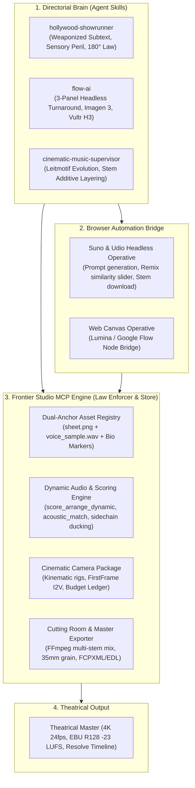

# Hollywood-Grade Production Pipeline Design Spec (Frontier Studio v4)
**Document Version:** 4.0.0  
**Date:** 2026-11-22  
**Status:** Validated Design Spec  
**Target Architecture:** End-to-End Autonomous AI Film Studio with Directorial Intelligence, Multi-Modal Asset Continuity, Dynamic Scoring, and Browser Automation.

---

## 1. Executive Summary & Production Philosophy

Current AI video tools produce disjointed, low-stakes clips because they treat filmmaking as isolated text-to-video prompts. Real cinema is built on **biological and vocal continuity**, **sensory tension and subtext**, **dynamic musical scoring**, and **precise editorial grammar**.

This specification defines the architecture to upgrade `frontier-studio-mcp` and its accompanying agent skills into a full-scale, broadcast-compliant (**EBU R128 / SMPTE 24fps / FCPXML 1.10**) production studio.

---

## 2. System Architecture: The 4 Cohesive Subsystems

---

## 3. Subsystem Specifications

### Subsystem 1: The Dual-Anchor Character Dossier & Voice Sample Locking
* **Problem:** Text-only voice descriptions result in severe vocal timbre drift across shots. Video models cannot clone audio.
* **Specification:**
  1. `asset_register` schema is expanded to accept `voice_sample` (local path to a 48kHz WAV/MP3) or `voice_id` (cloned voice profile).
  2. Character asset directory (`films/<film_id>/assets/characters/<asset_id>/`) stores:
     * `descriptor.md`: Textile, optical silhouette, and facial structure.
     * `sheet.png`: 3-panel headless turnaround (close-up portrait, headless torso, rear view).
     * `voice.md`: Vocal cadence, pitch, accent, and mannerisms.
     * `voice_sample.wav`: Physical reference audio (30s-60s clean studio speech).
     * `voice_profile.json`: Metadata linking the sample to Google Journey HD personas or ElevenLabs voice clones.
  3. `dialogue_render` automatically resolves `voice_sample.wav` or `voice_profile.json` to synthesize 48kHz isolated WAV stems matching the locked actor identity.

### Subsystem 2: Biological Multi-Age Inheritance (Baby → Kid → Adult)
* **Problem:** Generational storytelling (e.g. *The Mother's Monster*) suffers from facial morphing where the baby looks completely unrelated to the adult.
* **Specification:**
  1. The character store adds `biological_markers`:
     * `iris_color_hex`: Hex code for eye color (e.g., `#3d607a`).
     * `bone_structure`: Jaw, cheekbone, and orbital ridge specifications.
     * `signature_marks`: Permanent scars, moles, or birthmarks.
     * `ethnic_ancestry`: Specific ancestral genetic markers.
  2. When registering an age variant (e.g. `corvus_baby`, `corvus_child`, `corvus_adult` with `parent_dna: "corvus"`), the prompt compiler automatically injects the invariant biological markers while adjusting cranial proportion, skin texture, and stature.

### Subsystem 3: Dynamic Music Supervision & Additive Stem Arrangement
* **Problem:** Stock background music is static and drowns dialogue or misses emotional climaxes.
* **Specification:**
  1. New Tool: `score_arrange_dynamic` in `src/tools/audio.ts`:
     * Accepts `theme_id` or `stems_dir`, along with an array of shot-by-shot dramatic states:
       * `felt_whisper`: Solo melody stem only, -18dB volume, low-pass filter at 650Hz.
       * `creeping_dread`: Melody + 35Hz sub-bass drone stem, -12dB volume.
       * `epic_swell`: Full unmute (Melody + Drone + War Percussion + Choral brass) hitting at 0dB on the exact impact frame.
       * `vacuum_silence`: Instant drop to -∞dB for visceral shock.
  2. **Automated Sidechain Spectral Ducking:**
     * During speech, the music track's 1kHz–4kHz range ducks by 14dB in 80ms, maintaining the 35Hz sub-bass floor without muddying dialogue.
  3. Output: `audio/score_master.wav` normalized to EBU R128 (-23 LUFS).

### Subsystem 4: Headless Browser Automation (Suno / Udio / Web Canvases)
* **Problem:** Third-party generative audio and canvas tools lack complete or affordable programmatic APIs.
* **Specification:**
  1. Add a headless browser execution suite under `scripts/browser/`:
     * Uses Playwright / Chrome DevTools MCP / `gstack` to run background automation.
  2. **`suno_udio_browser.ts`:**
     * Authenticates into Udio / Suno.
     * Inputs the director's 4-bar leitmotif prompt.
     * Uses the Remix / Inpainting / Cover feature to generate the 3 emotional variations (Felt, Dread, Epic).
     * Downloads the resulting WAV tracks and isolates/places them into `films/<film_id>/audio/stems/`.
  3. **`canvas_bridge.ts`:**
     * Connects to infinite canvas interfaces (Lumina, Google Flow) for node-based visual staging and clip generation where required.

### Subsystem 5: Theatrical Cutting Room & Export (DaVinci Resolve / Premiere)
* **Specification:**
  1. `film_assemble`: Concatenates all `kept` shots with 0.3s audio J/L-cuts and crossfades.
  2. `film_grade`: Renders authentic Kodak Vision3 500T 35mm grain, photochemical color curves, and 2.39:1 cinemascope framing.
  3. `film_export_xml`: Generates universal **FCPXML 1.10** and **EDL** files with:
     * Video Track 1: All camera takes.
     * Audio Track 1: Isolated 48kHz dialogue stems.
     * Audio Track 2: Diegetic Foley & room tone.
     * Audio Track 3: Dynamic musical score stems.

---

## 4. Verification & Quality Gates

1. **Unit & Integration Tests (Vitest):**
   * Asset registry tests verifying `voice_sample.wav` storage and validation.
   * Audio lane tests verifying voice sample resolution and stem synthesis.
   * `score_arrange_dynamic` tests verifying stem volume envelopes and FFmpeg filtergraphs.
   * Continuity validator tests verifying biological marker propagation across age variants.
2. **The 261 Test Invariant:**
   * All 261 existing tests must continue to pass with zero regressions.
3. **Theatrical Delivery:**
   * Final output verified with `qa/critic.ts` (VLM kinematics and identity audit) and EBU R128 loudness verification.
